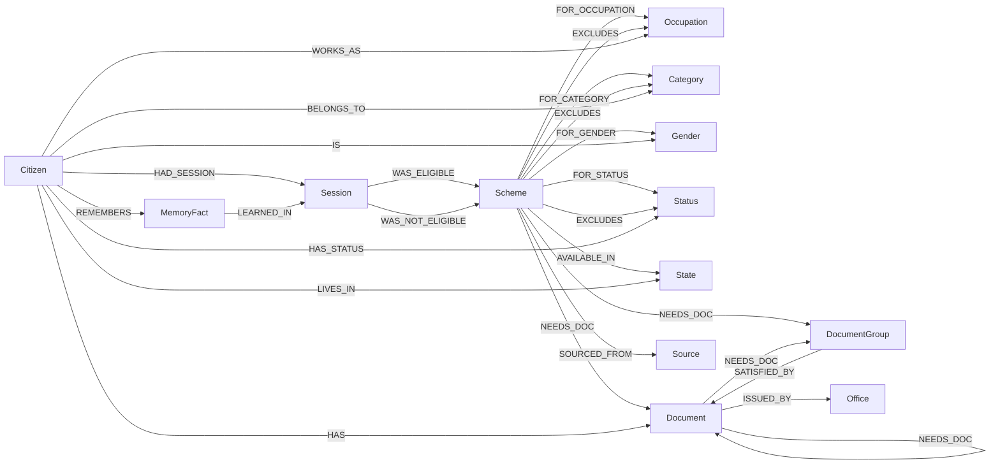

# YojanaSetu – Graph Model (v3)

Status: approved design, not built yet. Owner: Rusheek (data/, graph/).
All Cypher below is a draft and has not been run against FalkorDB yet.

## 0. Decisions

| # | Decision |
|---|---|
| D1 | Citizen stores `age` (not birth_year). The Session snapshot records when it was given. |
| D2 | Income = **annual household (family) income**. A scheme that uses individual income says so with an `income_basis` row in `scheme_criteria.csv`. |
| D3 | BPL, income-tax payer, government employee, … are `Status` nodes: `FOR_STATUS`, `EXCLUDES`, `HAS_STATUS`. `explain_not_eligible` names the excluding status. |
| D4 | Document alternatives use a minimal `DocumentGroup`: `(Scheme)-[:NEEDS_DOC]->(DocumentGroup)-[:SATISFIED_BY]->(Document)`. Single documents link directly. |
| D5 | At most 6 hand-entered scheme CSVs; small lists in one `lookups.csv`; `scheme_criteria.csv` is the single place for all eligibility rules. |
| D6 | No districts. State is the smallest place. |
| D7 | `best_next_document` ranks by schemes made **fully ready to apply**, tie-break by schemes **moved forward**. Returns both counts. |
| D8 | Optional `name_te` (Telugu name) column in `lookups.csv`, `schemes.csv`, `documents.csv`. Empty allowed. |
| D9 | `(Session)-[:WAS_NOT_ELIGIBLE {failed_checks}]->(Scheme)` stores near misses so memory can say what blocked the citizen last time. |
| D10 | All Cypher, including Session and MemoryFact writes, lives in `graph/queries.py`. `agent/` only calls those functions. |
| D11 | Synthetic citizens live in `fixtures/`. `data/` holds only human-verified scheme data. AI tools may generate fake citizens in `fixtures/`, never touch `data/` (in AGENTS.md). |

---

## 1. Schema

### 1.1 Diagram



### 1.2 Nodes

| Label | Key | Properties | Loaded from |
|---|---|---|---|
| Scheme | `scheme_id` | name, name_te, level (`central`/`state`), benefit (text), benefit_amount_inr (int, nullable), source_url, last_verified; **from criteria rows:** min_age, max_age, max_income, max_land_acres, income_basis (`household` default / `individual`) | schemes.csv + scheme_criteria.csv |
| Occupation | `id` | name, name_te | lookups.csv |
| Category | `id` | name, name_te | lookups.csv |
| Gender | `id` | name, name_te | lookups.csv |
| State | `id` | name, name_te | lookups.csv |
| Status | `id` | name, name_te (e.g. BPL, income-tax payer, govt. employee) | lookups.csv |
| Office | `id` | name, name_te, website | lookups.csv |
| Document | `doc_id` | name, name_te, description | documents.csv (`kind=document`) |
| DocumentGroup | `doc_id` | name, name_te (e.g. "Identity proof – any one"), description | documents.csv (`kind=group`) |
| Source | `url` | last_verified | derived from schemes.csv `source_url` |
| Citizen (synthetic) | `citizen_id` | display_name, age, annual_income, land_acres, created_at | fixtures/ (demo) + queries.py at runtime |
| Session | `session_id` | started_at, channel, profile_snapshot (JSON string of the profile as given in that session) | queries.py at runtime |
| MemoryFact | `fact_id` (= `citizen_id:key`) | key, value, created_at, updated_at | queries.py at runtime |

`Document` and `DocumentGroup` share one id space (`doc_id`), so one
`needs_doc` row can point at either and one "done" list covers both.

`name_te` is display-only. Matching always uses ids. If `name_te` is empty the
agent falls back to `name`.

Units:
- `max_income`, `annual_income`: **annual household income in INR** (integer).
- `max_land_acres`, `land_acres`: **acres** (float). 1 gunta = 0.025 acre.
- `min_age`, `max_age`: whole years, inclusive.
- No criteria row for a limit = **no limit**.

### 1.3 Relationships

| Relationship | Meaning |
|---|---|
| `(Scheme)-[:FOR_OCCUPATION\|FOR_CATEGORY\|FOR_GENDER\|FOR_STATUS]->(...)` | Scheme is restricted to these values |
| `(Scheme)-[:AVAILABLE_IN]->(State)` | Scheme is restricted to these states |
| `(Scheme)-[:EXCLUDES]->(Occupation\|Category\|Status)` | Disqualifiers |
| `(Scheme)-[:NEEDS_DOC]->(Document\|DocumentGroup)` | Required to apply |
| `(Document)-[:NEEDS_DOC]->(Document\|DocumentGroup)` | Paperwork chain: need B before you can get A |
| `(DocumentGroup)-[:SATISFIED_BY]->(Document)` | Any one of these documents is enough |
| `(Document)-[:ISSUED_BY]->(Office)` | Where to get it (can be several) |
| `(Scheme)-[:SOURCED_FROM]->(Source)` | Official page the rules came from |
| `(Citizen)-[:WORKS_AS\|BELONGS_TO\|IS\|HAS_STATUS\|LIVES_IN]->(...)` | Citizen profile |
| `(Citizen)-[:HAS]->(Document)` | Documents already held |
| `(Citizen)-[:HAD_SESSION]->(Session)` | Conversation history |
| `(Session)-[:WAS_ELIGIBLE {checked_at}]->(Scheme)` | Schemes the citizen qualified for in that session |
| `(Session)-[:WAS_NOT_ELIGIBLE {checked_at, failed_checks}]->(Scheme)` | Near misses in that session; `failed_checks` is a JSON string (FalkorDB properties can't hold maps) |
| `(Citizen)-[:REMEMBERS]->(MemoryFact)` | Long-term memory |
| `(MemoryFact)-[:LEARNED_IN]->(Session)` | Session(s) in which the fact was given or changed |

A citizen never `HAS` a DocumentGroup. A group counts as done when the
citizen has **any** of its `SATISFIED_BY` documents.

### 1.4 Matching rules (the core of the eligibility logic)

1. **No edge = no restriction.** No `FOR_GENDER` edge = open to every gender;
   no `AVAILABLE_IN` edge = nationwide. Same for occupation, category, status.
2. **OR inside a dimension, AND across dimensions.**
3. **No limit row = no limit** for age, income and land.
4. **EXCLUDES beats everything** – occupation, category or status.
5. **Household vs individual income.** Individual income can never be higher
   than household income, so household income within the limit ⇒ eligible
   for both kinds of scheme. If household income is over the limit on an
   `individual` scheme, `find_eligible` leaves it out (never a false "yes")
   and `explain_not_eligible` returns `ask_individual_income`, so the agent
   asks instead of rejecting.
6. **Unknown data is not a "no".** Missing age/income/land → the scheme is
   left out of `find_eligible`; `explain_not_eligible` reports `actual = null`
   so the agent asks.
7. **Excluding statuses must be confirmed.** No `HAS_STATUS` edge to
   "income-tax payer" may just mean "not asked yet".
   `explain_not_eligible` returns `exclusions_to_confirm`.
8. **Eligible ≠ ready to apply.** Documents are a separate step.
9. **Near miss** = a scheme with exactly **one** failed check, or any scheme
   the citizen explicitly asked about and failed. Only these are stored as
   `WAS_NOT_ELIGIBLE`, so memory stays short and useful.

### 1.5 Design choices and why

| Choice | Why |
|---|---|
| Stable id on every node | Names get re-worded or translated; ids keep CSV joins and MERGE stable |
| "No edge = no restriction" | Central schemes don't need 36 state edges; one rule to explain |
| `EXCLUDES` + `Status` | Disqualifiers (income-tax payer, govt. employee) are real; without them we show false positives |
| `DocumentGroup` | "Aadhaar OR voter ID" without building a rules engine |
| `NEEDS_DOC` used for both Scheme→Doc and Doc→Doc | One variable-length traversal returns the whole paperwork chain |
| `source_url` on Scheme + `Source` node | Property guarantees every answer has a URL (hard rule); node shows provenance in the graph view |
| `income_basis` property | Makes "individual income" machine-readable, not a comment |
| Profile snapshot on Session | Eligibility changes when age/income change; the snapshot explains why an old answer differed |
| `MemoryFact.key` + deterministic `fact_id` | Updating "land_acres" overwrites the old value instead of piling up duplicates |
| `WAS_NOT_ELIGIBLE` with `failed_checks` | "Last time you were blocked only by the income certificate" comes from the graph, not the LLM |
| Writes in `graph/queries.py` | One file holds every query that touches the graph; judges can audit it in one place |

---

## 2. CSV files

### 2.1 Scheme data – `data/`, 5 files, hand-entered and verified by humans

**`data/lookups.csv`**
```
type,id,name,name_te,website
```
`type` ∈ `occupation`, `category`, `gender`, `state`, `status`, `office`.
`website` only for offices. `id` is unique within its type.

**`data/schemes.csv`**
```
scheme_id,name,name_te,level,benefit,benefit_amount_inr,source_url,last_verified
```
`source_url` is mandatory.

**`data/scheme_criteria.csv`** – the only place eligibility rules live
```
scheme_id,criterion,value,note
```

| `criterion` | `value` | Becomes |
|---|---|---|
| `min_age`, `max_age` | whole number | Scheme property |
| `max_income` | INR, whole number | Scheme property |
| `max_land_acres` | number | Scheme property |
| `income_basis` | `household` (default if no row) or `individual` | Scheme property |
| `for_occupation`, `for_category`, `for_gender`, `for_status` | lookup id | `FOR_*` edge |
| `available_in` | state id | `AVAILABLE_IN` edge |
| `excludes_occupation`, `excludes_category`, `excludes_status` | lookup id | `EXCLUDES` edge |

`note` is free text for the human verifier (e.g. which guideline clause).
It is never used in eligibility logic.

**`data/documents.csv`**
```
doc_id,kind,name,name_te,description
```
`kind` ∈ `document`, `group`.

**`data/document_links.csv`**
```
from_id,link,to_id
```

| `link` | `from_id` | `to_id` |
|---|---|---|
| `needs_doc` | scheme_id or doc_id | doc_id (document or group) |
| `satisfied_by` | doc_id of a group | doc_id of a document |
| `issued_by` | doc_id of a document | office id from lookups.csv |

### 2.2 Synthetic demo citizens – `fixtures/`, 2 files (fake data only)

**`fixtures/citizens.csv`**
```
citizen_id,display_name,age,annual_income,land_acres,gender_id,state_id
```

**`fixtures/citizen_links.csv`**
```
citizen_id,link,value
```
`link` ∈ `works_as`, `belongs_to`, `has_status`, `has_doc`.

`Session` and `MemoryFact` have no CSV; `graph/queries.py` creates them at runtime.

### 2.3 Loader validation (fails loudly, never guesses)

- Unknown `type`, `criterion`, `kind` or `link` value.
- Any id that doesn't resolve (lookup, scheme, doc, office), or a `needs_doc`
  `from_id` that matches both a scheme and a doc.
- `satisfied_by` from a `document` or to a `group` (no nested groups).
- A `group` with fewer than 2 members.
- Empty `source_url`; `min_age > max_age`; a numeric criterion that isn't a number.
- The same numeric criterion twice for one scheme.
- Cycles in `needs_doc`.
- Fixtures loader: any id in `fixtures/` that doesn't exist in `data/`.

---

## 3. Draft Cypher – `graph/queries.py`

All queries use parameters, never string concatenation. Relationship types
can't be parameters in Cypher, so profile-link writes use one fixed query per
link type, chosen from a whitelist in Python. Paperwork traversal is capped
at depth 8.

### 3.1 Shared fragments

Defined once so every query uses exactly the same rules.

```cypher
// ELIGIBLE_WHERE  (expects bound c:Citizen and s:Scheme)
    (s.min_age        IS NULL OR c.age           >= s.min_age)
AND (s.max_age        IS NULL OR c.age           <= s.max_age)
AND (s.max_income     IS NULL OR c.annual_income <= s.max_income)
AND (s.max_land_acres IS NULL OR c.land_acres    <= s.max_land_acres)
AND (NOT (s)-[:FOR_OCCUPATION]->(:Occupation)
     OR  (s)-[:FOR_OCCUPATION]->(:Occupation)<-[:WORKS_AS]-(c))
AND (NOT (s)-[:FOR_CATEGORY]->(:Category)
     OR  (s)-[:FOR_CATEGORY]->(:Category)<-[:BELONGS_TO]-(c))
AND (NOT (s)-[:FOR_GENDER]->(:Gender)
     OR  (s)-[:FOR_GENDER]->(:Gender)<-[:IS]-(c))
AND (NOT (s)-[:FOR_STATUS]->(:Status)
     OR  (s)-[:FOR_STATUS]->(:Status)<-[:HAS_STATUS]-(c))
AND (NOT (s)-[:AVAILABLE_IN]->(:State)
     OR  (s)-[:AVAILABLE_IN]->(:State)<-[:LIVES_IN]-(c))
AND NOT (s)-[:EXCLUDES]->()<-[:WORKS_AS|BELONGS_TO|HAS_STATUS]-(c)
```

```cypher
// DONE_DOCS  (expects bound c; yields `done` = held doc_ids + satisfied group ids)
OPTIONAL MATCH (c)-[:HAS]->(h:Document)
WITH c, collect(h.doc_id) AS owned
OPTIONAL MATCH (g:DocumentGroup)-[:SATISFIED_BY]->(:Document)<-[:HAS]-(c)
WITH c, owned, collect(DISTINCT g.doc_id) AS groups_done
WITH c, owned + groups_done AS done
```

```cypher
// EXPLAIN_BODY  (expects bound c, s; yields failed_checks, excluded_by, exclusions_to_confirm)
WITH c, s,
     [(s)-[:FOR_OCCUPATION]->(x) | x.id] AS need_occ,
     [(c)-[:WORKS_AS]->(x)       | x.id] AS has_occ,
     [(s)-[:FOR_CATEGORY]->(x)   | x.id] AS need_cat,
     [(c)-[:BELONGS_TO]->(x)     | x.id] AS has_cat,
     [(s)-[:FOR_GENDER]->(x)     | x.id] AS need_gen,
     [(c)-[:IS]->(x)             | x.id] AS has_gen,
     [(s)-[:FOR_STATUS]->(x)     | x.id] AS need_status,
     [(c)-[:HAS_STATUS]->(x)     | x.id] AS has_status,
     [(s)-[:AVAILABLE_IN]->(x)   | x.id] AS need_state,
     [(c)-[:LIVES_IN]->(x)       | x.id] AS has_state,
     [(s)-[:EXCLUDES]->(x)<-[:WORKS_AS|BELONGS_TO|HAS_STATUS]-(c)
        | {type: labels(x)[0], id: x.id, name: x.name}] AS excluded_by,
     [(s)-[:EXCLUDES]->(x:Status) | {id: x.id, name: x.name}] AS excl_status
WITH c, s, excluded_by,
     [x IN excl_status WHERE NOT x.id IN has_status] AS exclusions_to_confirm,
     [r IN [
  CASE WHEN s.min_age IS NOT NULL AND (c.age IS NULL OR c.age < s.min_age)
       THEN {check: 'min_age', required: s.min_age, actual: c.age} END,
  CASE WHEN s.max_age IS NOT NULL AND (c.age IS NULL OR c.age > s.max_age)
       THEN {check: 'max_age', required: s.max_age, actual: c.age} END,
  CASE WHEN s.max_income IS NOT NULL AND (c.annual_income IS NULL OR c.annual_income > s.max_income)
       THEN {check: CASE WHEN s.income_basis = 'individual' AND c.annual_income IS NOT NULL
                         THEN 'ask_individual_income' ELSE 'max_income' END,
             required: s.max_income, actual: c.annual_income,
             basis: coalesce(s.income_basis, 'household')} END,
  CASE WHEN s.max_land_acres IS NOT NULL AND (c.land_acres IS NULL OR c.land_acres > s.max_land_acres)
       THEN {check: 'max_land_acres', required: s.max_land_acres, actual: c.land_acres} END,
  CASE WHEN size(need_occ) > 0 AND none(x IN has_occ WHERE x IN need_occ)
       THEN {check: 'occupation', required: need_occ, actual: has_occ} END,
  CASE WHEN size(need_cat) > 0 AND none(x IN has_cat WHERE x IN need_cat)
       THEN {check: 'category', required: need_cat, actual: has_cat} END,
  CASE WHEN size(need_gen) > 0 AND none(x IN has_gen WHERE x IN need_gen)
       THEN {check: 'gender', required: need_gen, actual: has_gen} END,
  CASE WHEN size(need_status) > 0 AND none(x IN has_status WHERE x IN need_status)
       THEN {check: 'status', required: need_status, actual: has_status} END,
  CASE WHEN size(need_state) > 0 AND none(x IN has_state WHERE x IN need_state)
       THEN {check: 'state', required: need_state, actual: has_state} END,
  CASE WHEN size(excluded_by) > 0
       THEN {check: 'excluded', required: [], actual: excluded_by} END
] WHERE r IS NOT NULL] AS failed_checks
```

### 3.2 Read queries

**find_eligible**

```cypher
MATCH (c:Citizen {citizen_id: $citizen_id})
MATCH (s:Scheme)
WHERE <ELIGIBLE_WHERE>
RETURN s.scheme_id AS scheme_id, s.name AS name, s.name_te AS name_te,
       s.level AS level, s.benefit AS benefit, s.source_url AS source_url
ORDER BY s.benefit_amount_inr DESC, s.name
```

**explain_not_eligible** – one scheme; empty `failed_checks` = eligible.

```cypher
MATCH (c:Citizen {citizen_id: $citizen_id}), (s:Scheme {scheme_id: $scheme_id})
<EXPLAIN_BODY>
RETURN s.scheme_id AS scheme_id, s.name AS name, s.source_url AS source_url,
       failed_checks, excluded_by, exclusions_to_confirm
```

Example the agent can say straight from the result: *"Not eligible for
PM-KISAN because it excludes the status **Income-tax payer**."*

**find_near_misses** – all schemes failing exactly one check.

```cypher
MATCH (c:Citizen {citizen_id: $citizen_id})
MATCH (s:Scheme)
<EXPLAIN_BODY>
WITH s, failed_checks WHERE size(failed_checks) = 1
RETURN s.scheme_id AS scheme_id, s.name AS name, s.source_url AS source_url,
       failed_checks
```

**document_path** – full paperwork chain for one scheme, deepest first. A
branch stops at anything already done. Group rows list alternatives in
`any_one_of`.

```cypher
MATCH (c:Citizen {citizen_id: $citizen_id})
<DONE_DOCS>
MATCH (s:Scheme {scheme_id: $scheme_id})
MATCH p = (s)-[:NEEDS_DOC|SATISFIED_BY*1..8]->(d)
WHERE none(n IN nodes(p)[1..-1] WHERE n.doc_id IN done)
WITH s, d, done, max(length(p)) AS depth
OPTIONAL MATCH (d)-[:ISSUED_BY]->(o)
RETURN d.doc_id AS doc_id, d.name AS name, d.name_te AS name_te,
       'DocumentGroup' IN labels(d) AS is_group,
       d.doc_id IN done AS done,
       depth,
       [(d)-[:SATISFIED_BY]->(m) | m.name] AS any_one_of,
       [(d)-[:NEEDS_DOC]->(pre) | pre.name] AS needs_first,
       collect(o.name) AS offices,
       s.source_url AS source_url
ORDER BY depth DESC, name
```

**best_next_document** – among missing documents the citizen can get **right
now** (all prerequisites done): rank by schemes it makes **fully ready**
(every direct requirement done once this document is added), then by schemes
it **moves forward** (appears anywhere in the scheme's open chain).

```cypher
MATCH (c:Citizen {citizen_id: $citizen_id})
<DONE_DOCS>
MATCH (s:Scheme)
WHERE <ELIGIBLE_WHERE>
MATCH p = (s)-[:NEEDS_DOC|SATISFIED_BY*1..8]->(d:Document)
WHERE NOT d.doc_id IN done
  AND none(n IN nodes(p)[1..-1] WHERE n.doc_id IN done)
  AND all(pre IN [(d)-[:NEEDS_DOC]->(x) | x.doc_id] WHERE pre IN done)
WITH DISTINCT d, s, done
WITH d, s, done,
     [(s)-[:NEEDS_DOC]->(r) | r.doc_id]                 AS reqs,
     [(g:DocumentGroup)-[:SATISFIED_BY]->(d) | g.doc_id] AS d_groups
WITH d, s,
     all(r IN reqs WHERE r IN done OR r = d.doc_id OR r IN d_groups) AS made_ready
WITH d, collect({scheme_id: s.scheme_id, name: s.name,
                 source_url: s.source_url, made_ready: made_ready}) AS helps
WITH d, helps,
     size([h IN helps WHERE h.made_ready]) AS schemes_made_ready,
     size(helps)                           AS schemes_moved_forward
OPTIONAL MATCH (d)-[:ISSUED_BY]->(o)
RETURN d.doc_id AS doc_id, d.name AS name, d.name_te AS name_te,
       schemes_made_ready, schemes_moved_forward, helps,
       collect(o.name) AS offices
ORDER BY schemes_made_ready DESC, schemes_moved_forward DESC, name
LIMIT 1
```

### 3.3 Write queries (Session and MemoryFact)

`agent/` calls these Python functions; it never writes Cypher itself.
Eligibility results are **computed inside the write**, so the agent cannot
record a scheme the graph didn't approve.

**start_session** – `profile_snapshot` is built in Python from the current
Citizen profile (via `get_profile`) and passed as a JSON string.

```cypher
MATCH (c:Citizen {citizen_id: $citizen_id})
CREATE (c)-[:HAD_SESSION]->(se:Session {
  session_id: $session_id, started_at: timestamp(),
  channel: $channel, profile_snapshot: $profile_snapshot})
RETURN se.session_id
```

**update_profile** – numeric fields only (Python whitelists the keys:
age, annual_income, land_acres).

```cypher
MATCH (c:Citizen {citizen_id: $citizen_id})
SET c += $props
```

**set_profile_link** – one fixed query per link type; shown for `WORKS_AS`.
Same shape for `BELONGS_TO`, `IS`, `HAS_STATUS`, `LIVES_IN`, `HAS`.

```cypher
MATCH (c:Citizen {citizen_id: $citizen_id}), (o:Occupation {id: $target_id})
MERGE (c)-[:WORKS_AS]->(o)
```

**record_eligible** – stores every scheme the citizen qualifies for now.

```cypher
MATCH (c:Citizen)-[:HAD_SESSION]->(se:Session {session_id: $session_id})
MATCH (s:Scheme)
WHERE <ELIGIBLE_WHERE>
MERGE (se)-[r:WAS_ELIGIBLE]->(s)
SET r.checked_at = timestamp()
RETURN count(s) AS recorded
```

**record_near_misses** – Python runs `find_near_misses` (plus
`explain_not_eligible` for schemes the citizen asked about), turns each
`failed_checks` into a JSON string, and passes the rows:

```cypher
MATCH (se:Session {session_id: $session_id})
UNWIND $rows AS row        // row = {scheme_id, failed_checks_json}
MATCH (s:Scheme {scheme_id: row.scheme_id})
MERGE (se)-[r:WAS_NOT_ELIGIBLE]->(s)
SET r.checked_at = timestamp(), r.failed_checks = row.failed_checks_json
```

**remember_fact** – upsert by key; `fact_id` is `citizen_id:key`.

```cypher
MATCH (c:Citizen {citizen_id: $citizen_id}), (se:Session {session_id: $session_id})
MERGE (c)-[:REMEMBERS]->(f:MemoryFact {fact_id: $citizen_id + ':' + $key})
ON CREATE SET f.key = $key, f.created_at = timestamp()
SET f.value = $value, f.updated_at = timestamp()
MERGE (f)-[:LEARNED_IN]->(se)
```

**recall** – facts plus what blocked the citizen in their last session.

```cypher
MATCH (c:Citizen {citizen_id: $citizen_id})
OPTIONAL MATCH (c)-[:REMEMBERS]->(f:MemoryFact)
WITH c, [x IN collect({key: f.key, value: f.value, updated_at: f.updated_at})
         WHERE x.key IS NOT NULL] AS facts
OPTIONAL MATCH (c)-[:HAD_SESSION]->(se:Session)
WITH c, facts, se ORDER BY se.started_at DESC LIMIT 1
OPTIONAL MATCH (se)-[r:WAS_NOT_ELIGIBLE]->(s:Scheme)
RETURN facts, se.started_at AS last_session_at,
       [x IN collect({name: s.name, failed_checks: r.failed_checks,
                      source_url: s.source_url})
        WHERE x.name IS NOT NULL] AS last_near_misses
```

### 3.4 FalkorDB syntax check results

Checked with `graph/syntax_check.py` on our FalkorDB instance (2026-10-15,
falkordb-py 1.2.2). The queries above already use the fallbacks.

Works as drafted: `NOT (pattern)` and pattern predicates reusing bound `c` in
`WHERE`; pattern comprehensions in `WITH` and inside `all(...)`;
`nodes(p)[1..-1]`; `labels(x)[0]`; map literals inside `CASE`; filtering a
list of `CASE` maps; variable-length paths over two types (`*1..8`);
`max(length(p))`; `ORDER BY … LIMIT 1` then `OPTIONAL MATCH`; `SET c += $props`;
`timestamp()`; string concatenation in a `MERGE` key; `UNWIND $rows`;
`CREATE INDEX`; two-property full-text index; unique constraints.

Failed, with the fallback we use:

| Feature | What happened | Fallback |
|---|---|---|
| Pattern comprehension whose `WHERE` contains a pattern, e.g. `[(s)-[:EXCLUDES]->(x) WHERE NOT (c)-[:HAS_STATUS]->(x) \| x.id]` | Error: `Type mismatch: expected Null but was Pointer`. A `WHERE` on properties (`x.id <> 'a'`) works. | Collect both sides as id lists first, then filter with a list comprehension: `[x IN excl_status WHERE NOT x.id IN has_status]` (see `EXPLAIN_BODY`). |
| Mixing an aggregate with another expression in one projection: `WITH c, owned + collect(...) AS done` | Error: `Unable to locate a value with alias owned`. | Aggregate in one `WITH`, combine in the next: `WITH c, owned, collect(...) AS groups_done WITH c, owned + groups_done AS done` (see `DONE_DOCS`). |
| Exact-length variable path `*3` or `*3..3` with both ends filtered | No error, but **no rows** even though the path exists. `*1..8` finds it. | Never use exact-length hops. Use a range (`*1..8`) and, if needed, `WHERE length(p) = n`. |

Rules for writing `graph/queries.py`:
1. No pattern predicates inside a pattern comprehension's `WHERE`.
2. Aggregate in one `WITH`; do arithmetic or `+` on the result in the next.
3. Variable-length paths always use a range, never a fixed length.
4. Re-run `python graph/syntax_check.py` after any FalkorDB upgrade.

---

## 4. Indexes

```cypher
CREATE INDEX FOR (n:Scheme)        ON (n.scheme_id)
CREATE INDEX FOR (n:Scheme)        ON (n.level)
CREATE INDEX FOR (n:Occupation)    ON (n.id)
CREATE INDEX FOR (n:Category)      ON (n.id)
CREATE INDEX FOR (n:Gender)        ON (n.id)
CREATE INDEX FOR (n:State)         ON (n.id)
CREATE INDEX FOR (n:Status)        ON (n.id)
CREATE INDEX FOR (n:Office)        ON (n.id)
CREATE INDEX FOR (n:Document)      ON (n.doc_id)
CREATE INDEX FOR (n:DocumentGroup) ON (n.doc_id)
CREATE INDEX FOR (n:Source)        ON (n.url)
CREATE INDEX FOR (n:Citizen)       ON (n.citizen_id)
CREATE INDEX FOR (n:Session)       ON (n.session_id)
CREATE INDEX FOR (n:MemoryFact)    ON (n.fact_id)
```

Unique constraints on the same keys (FalkorDB needs the index first):

```
GRAPH.CONSTRAINT CREATE yojanasetu UNIQUE NODE Scheme PROPERTIES 1 scheme_id
... same for Document.doc_id, DocumentGroup.doc_id, Citizen.citizen_id,
    Session.session_id, MemoryFact.fact_id, and each lookup label's id
```

Full-text indexes so the agent maps "rythu bandhu" or "caste certificate"
(English or Telugu) to an id without the LLM guessing:

```cypher
CALL db.idx.fulltext.createNodeIndex('Scheme', 'name', 'name_te')
CALL db.idx.fulltext.createNodeIndex('Document', 'name', 'name_te')
```

No indexes on numeric limits: a few hundred schemes at most, and every
eligibility query scans them all anyway.

---

## 5. Open questions

None blocking. Ready to build the loader once approved.
